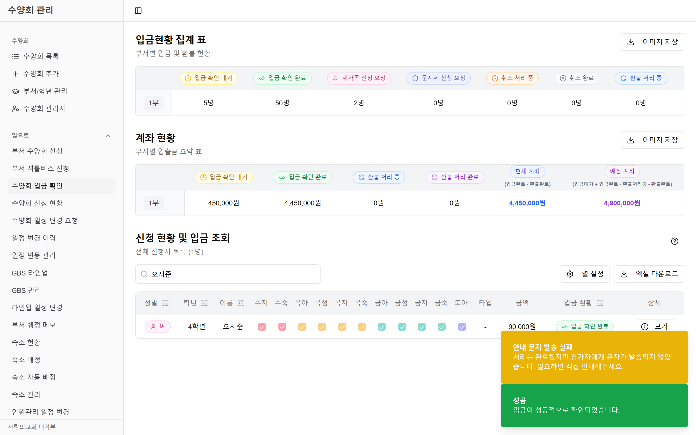
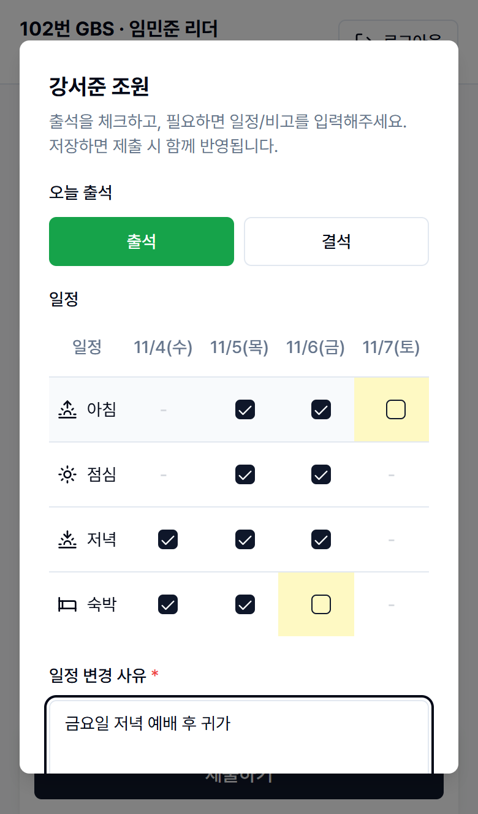
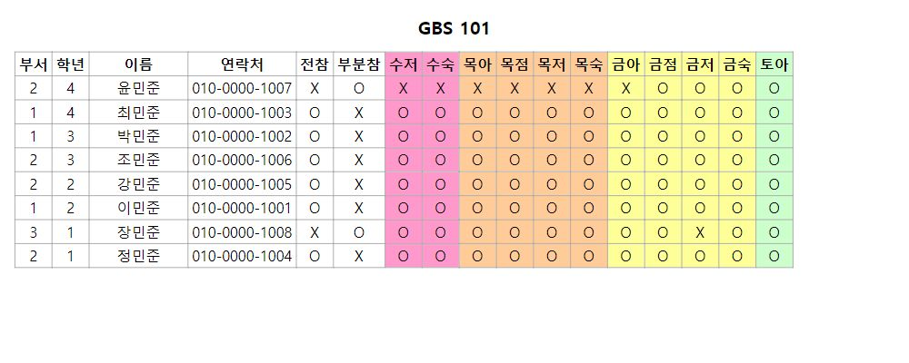

# 사랑의교회 대학부 수양회 시스템 — 2026 리팩토링 기록

2025년에 백엔드로 참여했던 수양회 관리 시스템(참가자 약 1,500명 실사용)을 2026년에 다시 열어,
**서버 · 관리자 웹 · 참가자 웹 세 저장소 전체를 개인적으로 리팩토링한 기록**입니다.

> 원 저장소는 단체 소유 비공개라 코드는 올리지 않았습니다. 요청하시면 로컬에서 직접 시연합니다.
> 진행: 김진영 · Claude Code 페어 프로그래밍 (탐색 · 반복 수정은 AI 와 함께, 무엇을 고칠지와 검증 기준은 직접 결정)

## 결과

| 무엇을 | 전 | 후 | 어떻게 |
|---|---|---|---|
| 꼬리표 이미지 생성 (150장 벤치) | 29.9s | **9.9s** | 장마다 페이지 생성 → 페이지 풀 워커 큐 |
| 실제 데이터 꼬리표 ZIP | **0장** (버그) | 205장 · 9.7s | `NULL != 'STAFF'` 조건 수정 |
| 참가자 폼 — 전화번호 13자 입력 시 렌더된 컴포넌트 | 882 | **14** | `useWatch` / `useFormState` 로 구독 범위 축소 |
| 관리자 First Load JS (GBS 라인업 / 셔틀 입금) | 781 / 732kB | **273 / 227kB** | xlsx · html2canvas 동적 import |
| 리더 포털 첫 화면 (요청당 300ms 지연 가정) | 2,508ms | **1,467ms** | 요청 폭포 → 병렬 prefetch |
| 쓰지 않는 관리자 코드 | — | **2,864줄 삭제** | 참조 없는 모듈 정리 |

규모: 커밋 64건 (서버 32 · 관리자 20 · 참가자 12) · +13.1k / −14.4k 줄 · 테스트 Jest 78(서버 44 · 관리자 34) · Vitest 95 · E2E 176

## 진행 방식

1. **동작 고정** — 고칠 로직을 순수 함수로 추출하고, 기존/새 구현의 결과를 비교하는 특성화 테스트를 먼저 작성
2. **측정 먼저** — 벤치 스크립트, Playwright 렌더 카운터, `next build` 크기로 숫자를 잰 뒤 수정
3. **화면 회귀** — mock API 기반 Playwright E2E 172개
4. **실제 스택 검증** — 로컬 PostgreSQL + 가짜 데이터 seed 로 세 앱을 띄워 38개 관리자 화면 순회 + 실제 DB E2E.
   mock 테스트가 모두 통과한 상태에서 **버그 12건을 더 찾았습니다.**

## 화면 (데모 seed 의 가짜 데이터)

| 입금 확인 — 저장 성공과 문자 실패를 분리 | 리더 포털 — 바뀐 일정 칸 강조 |
|---|---|
|  |  |

## 문서

| 문서 | 내용 |
|---|---|
| [01 꼬리표 이미지 파이프라인](docs/01-label-image-pipeline.md) | Puppeteer 페이지 풀 · 29.9s → 9.9s |
| [02 관리자 웹](docs/02-admin-refactor.md) | SWR 캐시 구조 · 테이블 렌더 · 번들 크기 · 죽은 코드 정리 |
| [03 참가자 웹](docs/03-retreat-web-performance.md) | 폼 리렌더 882 → 14 · 요청 폭포 · 접근성 |
| [04 실제 화면 검증](docs/04-live-verification.md) | 로컬 DB 로 돌려 보고 찾은 버그 12건 |

## 대표 트러블슈팅

- **저장은 됐는데 응답은 500** — 커밋 뒤 보내는 안내 문자가 실패하면 요청 전체가 실패로 처리됨 → 재신청 시 "이미 신청".
  문자 실패를 요청 결과와 분리(`notifyAfterCommit`)하고, 관리자 화면에는 경고로만 표시.
- **꼬리표 이미지에 일반 참가자가 0명** — SQL 에서 `NULL != 'STAFF'` 는 참이 아님. 엑셀 쿼리와 같은 조건으로 통일.
- **엑셀 시간이 서버 시간대에 따라 9시간 밀림** — `+9h` 뒤 `getHours()` 로 읽던 코드를 `getUTC*` 기반 `kstParts()` 로 통일, 세 시간대에서 같은 결과를 내는 테스트 추가.

## 기술

TypeScript · Express · Knex · PostgreSQL · Puppeteer · Next.js 14 · SWR · TanStack Table · React Query · React Hook Form · Playwright · Jest · Vitest
